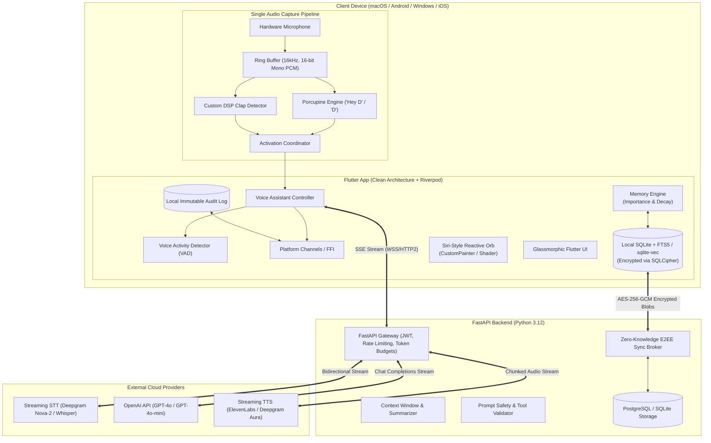
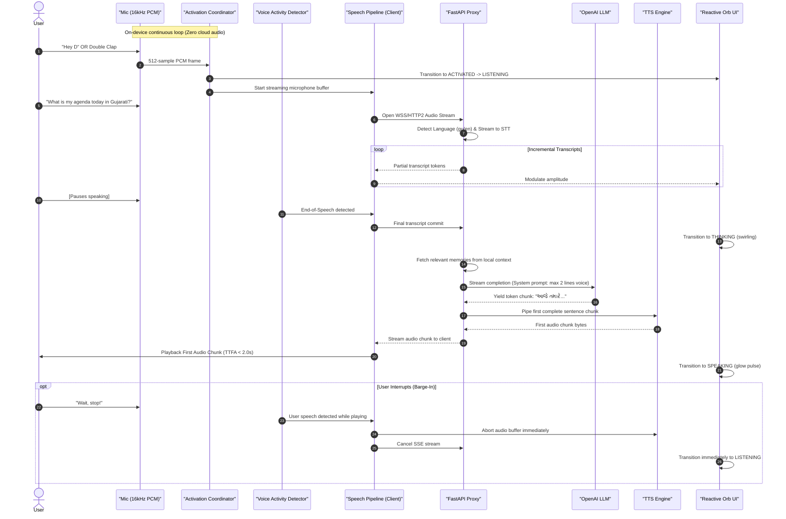
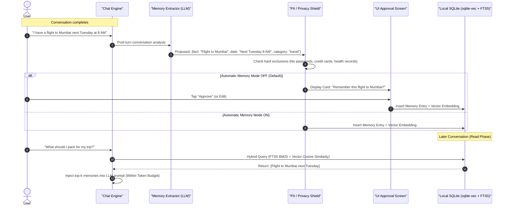
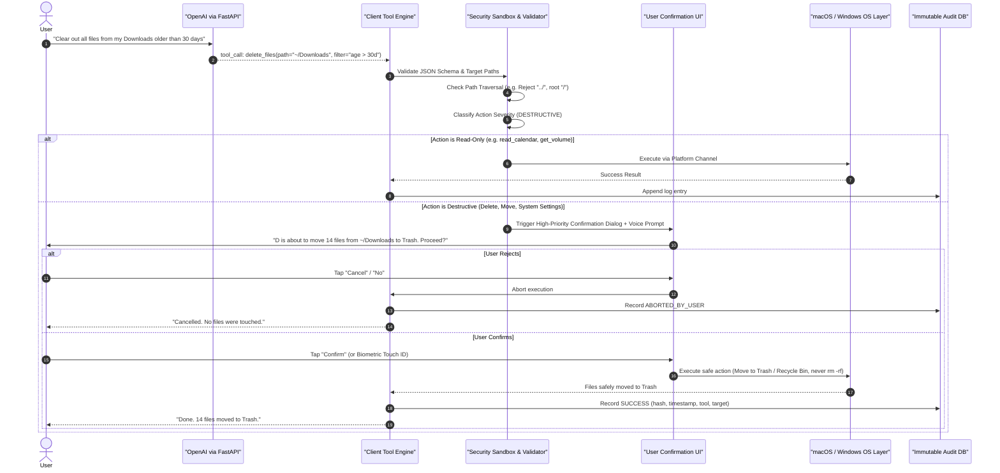
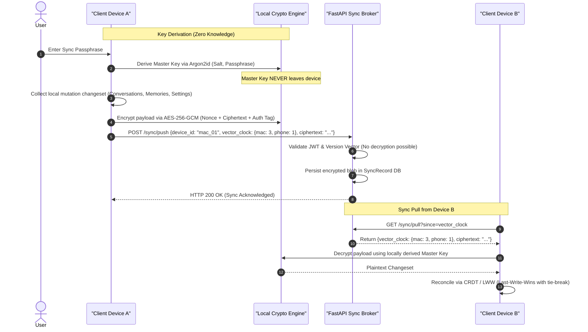
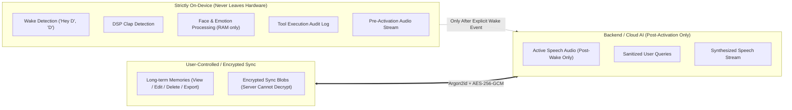
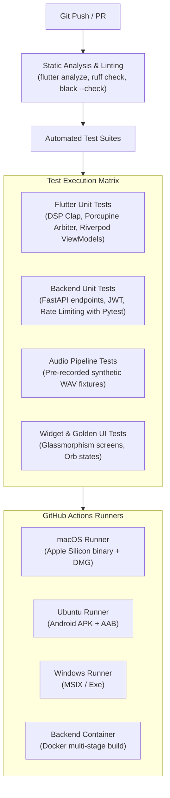

# D AI — System Architecture Specification (Phase 0)

> **Document Version:** 1.0.0  
> **Status:** Architecture Blueprint (Phase 0 — Complete, No Code Generated)  
> **Target Platforms:** macOS (Apple Silicon native), Android (API 26+), Windows (x64/ARM64), iOS (App Intents / Siri Shortcuts fallback)  
> **Core Principle:** Privacy-first, voice-first, local-first intelligence with zero client-side secrets.

---

## 1. System Architecture Overview

D is architected around a **Local-First, Cloud-Augmented Client-Server Topology**. The client application operates autonomously for wake detection, acoustic DSP (clap recognition), local caching, long-term memory retrieval, and system automation. High-compute generative AI capabilities (Streaming STT, LLM reasoning, Streaming TTS) are brokered through a dedicated **FastAPI Backend Proxy**.



### Component Breakdown
1. **Frontend (Flutter 3.24+):**
   - **Presentation:** MVVM with Riverpod (`AsyncNotifier`, StateNotifier, code-gen). Reactive UI rendered with dynamic glassmorphism and an audio-reactive particle orb.
   - **Domain:** Pure Dart entities, use cases, and repository interfaces. Completely decoupled from UI and platform APIs.
   - **Data:** Repository implementations, Drift SQLite ORM, HTTP/SSE networking clients, and platform channel adapters.
2. **Backend Proxy (FastAPI 0.111+, Python 3.12):**
   - Serves as the single security barrier between user clients and cloud AI providers.
   - Enforces JWT authentication, sliding-window rate limiting, per-user token expenditure quotas, context window pruning, and prompt-injection defense layers.
3. **Local Database & Vector Memory:**
   - SQLite wrapped via `drift` with `sqlcipher` encryption.
   - Semantic retrieval using `sqlite-vec` or local embedding projections combined with SQLite `FTS5` full-text search for hybrid BM25 + cosine similarity lookup.
4. **Cloud Sync Service:**
   - Zero-Knowledge End-to-End Encryption (E2EE).
   - Cryptographic keys derived exclusively on-device from user credentials via Argon2id. Server stores opaque ciphertext and vector clocks for conflict resolution.

---

## 2. Folder Structure

### 2.1 Flutter Client (`apps/client/`)
```
apps/client/
├── android/                         # Android native source & Gradle configs
├── ios/                             # iOS native source & AppIntents definitions
├── macos/                           # macOS AppKit runner, menu bar agent, entitlements
├── windows/                         # Windows Win32 runner & resource definitions
├── assets/
│   ├── audio/                       # Calibration tones & fallback sound effects
│   ├── icons/                       # Platform tray & app icons
│   ├── models/                      # Porcupine keyword files (.ppn)
│   └── shaders/                     # GLSL fragment shaders for glowing voice orb
├── lib/
│   ├── main.dart                    # App bootstrap & global error boundary
│   ├── core/                        # Shared cross-cutting infrastructure
│   │   ├── config/                  # App constants (AppConstants.appName = "D"), flavors (dev/prod)
│   │   ├── constants/               # Token budgets, latency thresholds, timing windows
│   │   ├── errors/                  # Typed failures, exception hierarchy
│   │   ├── network/                 # SSE client, Dio interceptors, retry with exponential backoff
│   │   ├── router/                  # GoRouter configuration & guards
│   │   ├── security/                # Keychain / Keystore access, Argon2id & AES-256-GCM helpers
│   │   ├── storage/                 # Drift database schema, migrations, SQLCipher configuration
│   │   ├── theme/                   # Glassmorphic tokens, dark/light color schemes, typography
│   │   ├── localization/            # S.dart (en, hi, gu strings and code-switching formats)
│   │   └── utils/                   # Math, DSP helpers, audio buffer utilities
│   ├── features/                    # Feature-first modules
│   │   ├── activation/              # Phase 5: Wake word & clap detection
│   │   │   ├── data/                # Porcupine binding, native mic stream data source
│   │   │   ├── domain/              # DSP clap algorithm, activation models, state machine
│   │   │   └── presentation/        # Calibration UI, sensitivity sliders, audio level meter
│   │   ├── speech/                  # Phase 3: Speech to Text (STT)
│   │   │   ├── data/                # Deepgram/Whisper streaming client, native STT fallback
│   │   │   ├── domain/              # STT repository interface, VAD segmenter
│   │   │   └── presentation/        # Real-time transcript preview, active listening badge
│   │   ├── tts/                     # Phase 4: Text to Speech (TTS)
│   │   │   ├── data/                # Streaming audio chunk decoder, flutter_tts fallback
│   │   │   ├── domain/              # Speech queue manager, barge-in controller, sentence splitter
│   │   │   └── presentation/        # Voice settings, emotion/speed selectors
│   │   ├── chat/                    # Phase 2: Chat & LLM interactions
│   │   │   ├── data/                # Chat repository, message DTOs, SSE parser
│   │   │   ├── domain/              # Conversation entity, send message use case
│   │   │   └── presentation/        # Glassmorphic chat screen, markdown token renderer
│   │   ├── orb/                     # Phase 8: Siri-style reactive orb
│   │   │   ├── presentation/        # OrbWidget, CustomPainter, shader controllers
│   │   │   └── domain/              # Audio amplitude transformer, orb state enum
│   │   ├── memory/                  # Phase 9: Long-term memory engine
│   │   │   ├── data/                # sqlite-vec repository, memory DAO
│   │   │   ├── domain/              # Memory extractor, importance decay scoring, hard exclusions
│   │   │   └── presentation/        # Memory explorer, search, edit, JSON export view
│   │   ├── automation/              # Phase 11 & 12: macOS & Windows automation
│   │   │   ├── data/                # Platform channel adapters (AppleScript, JXA, Win32, PowerShell)
│   │   │   ├── domain/              # Tool schemas, confirmation policies, audit logger
│   │   │   └── presentation/        # Tool confirmation modal, audit log viewer
│   │   ├── vision/                  # Phase 13: Face & emotion estimate (opt-in)
│   │   │   ├── data/                # ML Kit / MediaPipe camera stream processor
│   │   │   ├── domain/              # 70% confidence filter, 5s cooldown, privacy guard
│   │   │   └── presentation/        # Emotion dashboard, camera privacy consent modal
│   │   ├── sync/                    # Phase 15: End-to-end encrypted cloud sync
│   │   │   ├── data/                # Sync API client, encrypted change-set generator
│   │   │   └── domain/              # Vector clock resolver, conflict reconciler
│   │   └── settings/                # Phase 7: App preferences & toggles
│   └── platform/                    # MethodChannel & EventChannel interfaces
│       ├── macos_channels.dart      # Menu bar, global hotkey, accessibility bindings
│       ├── android_channels.dart    # Foreground service, battery optimization bindings
│       └── windows_channels.dart    # System tray, startup registry bindings
└── test/                            # Unit, widget, and golden test suites
```

### 2.2 FastAPI Backend (`apps/backend/`)
```
apps/backend/
├── alembic/                         # Database schema migrations
├── app/
│   ├── main.py                      # FastAPI app factory, CORS, exception handlers, middleware
│   ├── core/
│   │   ├── config.py                # Pydantic v2 settings (reads from .env only)
│   │   ├── security.py              # JWT generation, Argon2 password hashing, token validation
│   │   ├── rate_limit.py            # Sliding-window token-bucket rate limiter
│   │   ├── logging.py               # Structured JSON logger (PII-sanitized)
│   │   └── exceptions.py            # Custom HTTP exceptions with consistent error schemas
│   ├── api/
│   │   ├── deps.py                  # Database session, authenticated user injection
│   │   └── v1/
│   │       ├── api.py               # Central APIRouter mounting all v1 endpoints
│   │       ├── endpoints/
│   │       │   ├── auth.py          # /auth/register, /auth/login, /auth/refresh
│   │       │   ├── chat.py          # POST /chat/stream (SSE streaming with OpenAI)
│   │       │   ├── speech.py        # Streaming STT/TTS broker endpoints
│   │       │   ├── memory.py        # Remote memory extraction & summarization assists
│   │       │   ├── sync.py          # POST /sync/push, GET /sync/pull (encrypted blobs)
│   │       │   └── health.py        # /health, /metrics (Prometheus ready)
│   ├── models/                      # SQLAlchemy ORM database models
│   │   ├── user.py                  # User account, tier, hashed password
│   │   ├── token_budget.py          # Daily/monthly token usage tracking
│   │   └── sync_record.py           # Device metadata, encrypted payload blobs, version vectors
│   ├── schemas/                     # Pydantic v2 request/response validation schemas
│   │   ├── auth.py                  # Token schemas, login requests
│   │   ├── chat.py                  # ChatCompletionRequest, ToolCall schemas, SSE chunks
│   │   └── sync.py                  # EncryptedPayloadDTO, VectorClockDTO
│   ├── services/                    # Business logic and external API integrations
│   │   ├── openai_service.py        # Async client, streaming parser, backoff retry
│   │   ├── context_service.py       # Context window trimmer, old conversation summarizer
│   │   ├── prompt_guard.py          # Delimiter enforcement, prompt injection detection
│   │   └── token_service.py         # Token counter (tiktoken) & quota enforcer
│   └── repositories/                # Data access abstraction
├── tests/
│   ├── conftest.py                  # Pytest fixtures, mock OpenAI client, test SQLite DB
│   ├── test_auth.py                 # Registration, login, invalid JWT tests
│   ├── test_chat_stream.py          # SSE streaming and backoff behavior tests
│   └── test_sync.py                 # Encrypted blob push/pull validation tests
├── Dockerfile                       # Multi-stage production container build
├── docker-compose.yml               # Backend + Redis + Postgres local environment
├── requirements.txt                 # Pinned Python dependencies
└── pyproject.toml                   # Ruff, Black, Pytest, MyPy configurations
```

---

## 3. Data-Flow Diagrams

### (a) Activation -> STT -> LLM -> TTS Pipeline (Target: < 2.0s Time-to-First-Audio)



### (b) Long-Term Memory Read / Write Flow



### (c) Automation Tool Execution with Confirmation Barrier



### (d) End-to-End Encrypted (E2EE) Cloud Sync



---

## 4. Activation Design: Dual-Engine Audio Sharing & DSP Calibration

### 4.1 Single Audio Pipeline Architecture
Operating both wake word recognition and clap detection concurrently requires sharing **one unified raw PCM stream** to prevent audio device lockouts, race conditions, and battery drain:

```mermaid
flowchart TD
    HardwareMic["OS Audio Source (Microphone)"] --> AudioRecord["Native Audio Driver (16kHz, 16-bit Mono PCM)"]
    AudioRecord --> SharedPipe["AudioCaptureService (Thread-Safe Ring Buffer)"]
    
    SharedPipe --> FrameSplitter["Frame Dispatcher (Zero-Copy)"]
    
    FrameSplitter -->|512 samples / 32ms| PorcupinePipe["Porcupine Worker"]
    FrameSplitter -->|128 samples / 8ms| ClapDSP["DSP Clap Detector"]
    
    PorcupinePipe --> WakeResult{"Wake Word Match?"}
    WakeResult -->|"Hey D" (Score >= 0.7)| Arbiter["ActivationCoordinator"]
    WakeResult -->|"D" (Score >= 0.85 & Enabled)| Arbiter
    WakeResult -->|No Match| Drop1["Ignore"]
    
    ClapDSP --> ClapState{"Clap Event?"}
    ClapState -->|Single Transient| DoubleClapTimer["Window Timer (300ms - 800ms)"]
    DoubleClapTimer -->|Second Transient in Window| Arbiter
    DoubleClapTimer -->|< 300ms (Echo) or > 800ms (Timeout)| ResetClap["Reset State"]
    
    Arbiter --> StateCheck{"Is D Already Listening / Speaking / In Cooldown?"}
    StateCheck -->|Yes| Drop2["Suppress Event"]
    StateCheck -->|No| Trigger["Dispatch Wake Event -> Voice Pipeline"]
```

### 4.2 Custom DSP Clap Detection Mechanics
The clap detector is implemented as a **pure Dart/native DSP module** with zero cloud latency:
1. **Short-Window RMS Energy & Attack Rate:**
   $$\text{Attack Rate} = \frac{E_{\text{current}} - E_{\text{previous}}}{\Delta t}$$
   A true hand clap produces an instantaneous burst of acoustic energy with an attack time $< 4\text{ ms}$.
2. **Decay Time Check:**
   Hand claps dissipate sharply within $20\text{–}40\text{ ms}$. If high energy persists for $> 60\text{ ms}$, the sound is rejected as human vocal plosives ("P", "B", "T"), music, or sustained noise.
3. **High-Frequency Energy Ratio (HFER):**
   $$\text{HFER} = \frac{\sum_{f=2000\text{Hz}}^{8000\text{Hz}} |X(f)|^2}{\sum_{f=20\text{Hz}}^{8000\text{Hz}} |X(f)|^2}$$
   Claps exhibit strong acoustic energy between $2.5\text{ kHz}$ and $6\text{ kHz}$. Door slams, thumps, and footsteps concentrate energy below $800\text{ Hz}$ and are rejected by requiring $\text{HFER} \ge 0.60$.
4. **Adaptive Noise Floor Tracking:**
   $$\text{NoiseFloor}_{t} = (1 - \alpha) \cdot \text{NoiseFloor}_{t-1} + \alpha \cdot E_{\text{ambient}}$$
   The baseline threshold dynamically floats with background television, air conditioners, or street noise using an asymmetric filter ($\alpha_{\text{rise}} = 0.001$, $\alpha_{\text{decay}} = 0.05$).
5. **False Positive Suppression & Calibration:**
   - **Self-Voice Cancellation:** Whenever D is speaking (TTS active), all clap and wake detection inputs are gated to prevent feedback triggers.
   - **Interactive Calibration Screen:** Users perform two claps in their environment; the detector measures ambient SNR and sets an optimal detection threshold.

---

## 5. Technology Decisions, Justifications, and Alternatives

| Component | Selected Technology | Justification | Considered Alternatives & Rejection Reason |
| :--- | :--- | :--- | :--- |
| **STT Provider** | **Deepgram Nova-2** (Primary) + Whisper API (Secondary) + Native OS (Offline) | Ultra-low streaming latency (< 300ms TTFT), best-in-class multi-dialect support for **Hinglish code-switching**, native **Hindi** and **Gujarati** models. | *Whisper Local:* Too CPU/memory intensive for mobile background services.<br>*Google Cloud STT:* Higher pricing, higher latency for streaming chunks. |
| **TTS Provider** | **ElevenLabs Flash v2** / Deepgram Aura + `flutter_tts` (Offline) | Natural conversational cadence, expressive inflection, streaming WebSockets audio response, multilingual Hindi/Gujarati output. | *OpenAI TTS:* Higher initial chunk latency (~800ms vs ~250ms with ElevenLabs Flash). |
| **Client State Management** | **Riverpod 2.5+** (Code-Gen + AsyncNotifier) | Strict compile-time safety, seamless stream integration, clean separation of concerns, no BuildContext requirement in business logic. | *Bloc:* Excessive boilerplate for fast-iterating audio pipelines.<br>*GetX:* Anti-pattern; poor testability, memory leak vulnerabilities. |
| **Local Database & Vector Search** | **SQLite via Drift + `sqlite-vec` + FTS5** | SQLite is bulletproof on mobile/desktop; Drift provides type-safe Dart queries; `sqlite-vec` enables local cosine similarity embeddings without remote vector DB costs. | *Chroma / Pinecone:* Violates local-first privacy rule and adds external network dependencies.<br>*ObjectBox:* Proprietary license concerns, larger binary footprint. |
| **Backend Framework** | **FastAPI (Python 3.12)** + Pydantic v2 | High concurrency via async event loop, native Server-Sent Events (SSE) support, robust ecosystem for AI SDKs, instant OpenAPI docs. | *Node.js/Express:* Weaker data science / ML ecosystem.<br>*Go:* Higher development time for rapid AI schema iterations. |

---

## 6. Per-Platform Background Strategy

### 6.1 macOS (Apple Silicon Native)
- **Execution Mode:** Menu bar agent (`NSStatusItem`) with dock icon suppressed via `LSUIElement = 1` in `Info.plist` (toggleable in Settings).
- **Persistence:** Generated `LaunchAgent` plist located in `~/Library/LaunchAgents/com.d.assistant.plist` configured with `RunAtLoad = true`.
- **Window Lifecycle:** Overrides `NSWindowDelegate.windowShouldClose` to hide the window instead of terminating the process.
- **Global Hotkey:** Registers a Carbon `RegisterEventHotKey` or `NSEvent.addGlobalMonitorForEvents` fallback (default: `Option + Space`) to activate D even if mic is muted.

### 6.2 Windows (x64 / ARM64)
- **Execution Mode:** Win32 system tray icon using `Shell_NotifyIconW`.
- **Persistence:** Registered in Windows Startup Registry: `HKCU\Software\Microsoft\Windows\CurrentVersion\Run\DAssistant`.
- **Window Lifecycle:** Intercepts `WM_CLOSE` to minimize to tray; captures global hotkey via `RegisterHotKey`.

### 6.3 Android (API 26–34+)
- **Execution Mode:** Long-running `ForegroundService` with explicit `android:foregroundServiceType="microphone"` in `AndroidManifest.xml` (mandatory for Android 14+).
- **Persistent Notification:** Non-dismissible Ongoing Notification with audio level indicator and "Pause Listening" quick action.
- **Battery Optimization:** Requests user authorization via `ACTION_REQUEST_IGNORE_BATTERY_OPTIMIZATIONS`.
- **Reboot Resilience:** `BOOT_COMPLETED` broadcast receiver restarts the listener if enabled by user.

### 6.4 iOS (Strict Platform Boundary Compliance)
> [!IMPORTANT]
> **Honest Architectural Truth on iOS:** Apple prohibits 24/7 background microphone listening for general assistant apps. Any attempt to use VoIP or audio recording background modes for continuous wake word detection when the app is in the background will be rejected during App Store review (Guidelines 2.5.4 & 5.1.1) and killed by iOS watchdog after 30 seconds.
- **Supported iOS Architecture:**
  1. **Siri Shortcuts & App Intents (`AppIntents` framework):** Native phrases like *"Hey Siri, ask D..."* or *"Hey Siri, open D"*.
  2. **Action Button / Back Tap Shortcut:** One-tap hardware trigger launches D directly into active listening mode.
  3. **Live Activity & Dynamic Island:** Persistent interactive session banner while the app is active in the foreground or temporarily backgrounded during active speech synthesis.
  4. **Always-On Wake Word:** Operates **only while the app is in the foreground / active on screen**.

---

## 7. Security Model & Threat Model (STRIDE)

| Threat Category | Potential Attack Vector | Architectural Mitigation in D |
| :--- | :--- | :--- |
| **Spoofing** | Attacker impersonates client to backend API; rogue wake word trigger. | JWT with short expiry (15m) + secure HTTP-only refresh tokens; wake word acoustic confidence thresholds; API secret rotation. |
| **Tampering** | Man-in-the-Middle modifies LLM prompt or tool parameters in transit. | Enforced TLS 1.3 with certificate pinning; HMAC signatures on critical tool payload schemas; local SQLite database encryption (SQLCipher). |
| **Repudiation** | User or malicious script claims D performed destructive actions without authorization. | Immutable local SQLite Audit Log recording every tool execution with timestamp, initiator, target file/app, and cryptographic execution status. |
| **Information Disclosure** | Leakage of API keys, mic audio recordings, or user memories. | **Zero keys on client.** Cloud AI keys exist only in backend env vars. Zero audio uploaded prior to activation. E2EE memory sync with client-side Argon2id key derivation. |
| **Denial of Service** | Infinite tool execution loops, prompt flooding, mic thread starvation. | Sliding-window token-bucket rate limiter per user/IP on backend; maximum execution timeout (15s) per tool call; watchdog timer on audio buffer thread. |
| **Elevation of Privilege** | **Prompt Injection:** Malicious text in user files/webpages tricks LLM into executing destructive commands (`delete_file`, etc.). | **Strict typed JSON tool schemas.** Untrusted text isolated into `<untrusted_content>` tags. **Destructive actions unconditionally trigger a user confirmation dialog (UI + voice).** No arbitrary shell execution permitted. |

---

## 8. Privacy Model



### Privacy Guarantees
1. **Audio Privacy:** Microphone audio is held strictly in a transient volatile ring buffer in RAM. Zero bytes are recorded to disk or transmitted to the network until a valid wake phrase or double clap is confirmed.
2. **Visual Indicator:** An unambiguous listening indicator (and macOS menu bar / Android notification icon) illuminates whenever the microphone hardware is active.
3. **Camera Data Hygiene:** Camera frames for emotion estimation are processed strictly in ephemeral RAM via ML Kit / MediaPipe, immediately discarded, and never saved or transmitted.
4. **Memory Hygiene & Absolute Blacklist:**
   - Prohibited from ever being stored in memory: Passwords, API tokens, credit card numbers, CVVs, bank details, government IDs, and protected health data.
   - User has one-tap "Clear All Memory" and "Export Memory to JSON" capabilities in Settings.

---

## 9. Testing Strategy and CI/CD Plan



### Key Testing Fixtures
- **DSP Clap Detector Fixture Suite:**
  - 20 synthetic clean double claps at various tempos (300ms, 500ms, 750ms).
  - 30 false-positive rejection tests (speech plosives, loud door slams, rapid typing on mechanical keyboards, coughing, television dialogue).
- **Backend Mocking:** Mock OpenAI streaming responses with simulated network drops and backoff validation.

---

## 10. Development Roadmap & Milestones

| Milestone | Target Deliverable | Critical Risks & Mitigations |
| :--- | :--- | :--- |
| **Phase 1: Scaffold** | Clean Architecture skeleton for Flutter & FastAPI, CI/CD, lint rules. | *Risk:* Dependency version conflicts across Flutter 3.24+.<br>*Mitigation:* Pin strict package versions. |
| **Phase 2: Core Chat** | JWT auth, SSE streaming chat, context management. | *Risk:* OpenAI rate limits & latency spikes.<br>*Mitigation:* Exponential backoff retry with user token quotas. |
| **Phases 3 & 4: Voice Pipeline** | Streaming STT (Deepgram/Whisper) & TTS (ElevenLabs) with barge-in. | *Risk:* Audio buffer underrun / high latency.<br>*Mitigation:* Stream first audio chunk immediately upon sentence boundary. |
| **Phase 5: Activation** | Unified audio capture with Porcupine wake word + custom DSP clap. | *Risk:* False clap triggers and microphone resource locking.<br>*Mitigation:* Adaptive noise floor, double-clap time gate, and ring buffer. |
| **Phase 6: Background Service** | macOS menu bar agent, Android foreground service, Windows tray. | *Risk:* Android 14 foreground service termination.<br>*Mitigation:* Follow strict `microphone` service type rules & battery whitelist. |
| **Phases 7 & 8: UI & Reactive Orb** | Glassmorphism screens, GLSL shader audio-reactive orb. | *Risk:* High GPU/battery drain from particle shaders.<br>*Mitigation:* Throttle frame rate to 60fps and downscale when in background. |
| **Phases 9 & 10: Memory & Personality** | SQLite vector search, prompt injection defense, persona engine. | *Risk:* Inaccurate memory retrieval or prompt injection.<br>*Mitigation:* Delimiter boundaries, hard exclusion regexes, user review. |
| **Phases 11 & 12: OS Automation** | macOS & Windows typed tool automation with confirmation barriers. | *Risk:* Accidental destructive file deletion.<br>*Mitigation:* Mandate explicit voice/UI confirmation and move to Trash/Recycle Bin only. |
| **Phases 13–15: Vision, Notifs, Sync** | Opt-in emotion detection, smart notifications, E2EE sync. | *Risk:* Camera privacy concerns.<br>*Mitigation:* Process in RAM only with 70% confidence threshold and cooldown. |
| **Phases 16 & 17: Security & Release** | Security audit, platform store signing, production release. | *Risk:* App Store rejection on iOS or macOS permissions.<br>*Mitigation:* Strict entitlement justifications and honest capability boundaries. |

